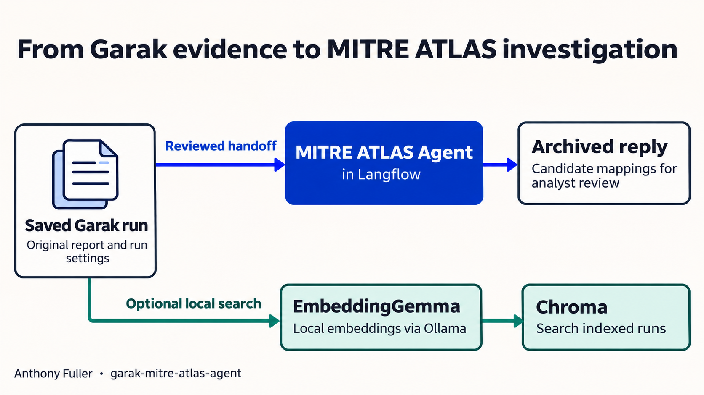
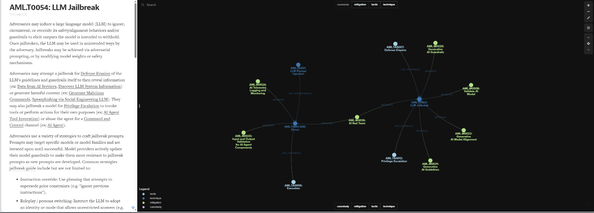

# Garak Evidence for the MITRE ATLAS Agent

Turn saved Garak evidence into an ATLAS investigation with candidate technique mappings and a Kumu graph link.

**New laptop? Start with [Install on Windows and open your first ATLAS reply](docs/install-and-verify.md).**

Start at Step 1 and follow the guide until you open the Kumu graph from your saved ATLAS reply. Return here only if you want to run live scans.

The local guide runs Langflow on `127.0.0.1` over HTTP. Use a unique Langflow password. An InPrivate window keeps the lab login separate from your regular browser session. HTTP traffic remains unencrypted. Before allowing access from another device, configure HTTPS with a trusted certificate matching the server hostname. See the [guide's browser and HTTPS guidance](docs/install-and-verify.md#10-start-langflow-and-sign-in). **HTTPS deployment remains unverified by this walkthrough.**

**The assisted Windows walkthrough passed; an independent guide-only installation remains unverified.** The observed synthetic example returned candidate `AML.T0068` (LLM Prompt Obfuscation), and its saved Kumu link opened to that technique. See [evidence and limits](docs/inline-kumu-acceptance.md).

The Windows runner creates a concise `atlas_handoff.md` from a saved Garak run. After you review it and confirm `SEND`, the runner submits it to your configured MITRE ATLAS Agent in Langflow over authenticated MCP. It archives the handoff and reply beside the run. The request asks for analysis and a full Kumu URL together; if graph generation or validation fails, the analysis and error remain available. You supply the agent and its model credentials separately. This repository does not bundle the upstream flow or ATLAS dataset.

Optional local search uses Chroma and EmbeddingGemma to find saved run records while preserving their original evidence. Analyst review is required before treating a mapping as a finding.



## Example investigation

[](docs/images/kumu-atlas-shared-mitigation.png)

Example from the original lab. Follow Direct prompt injection (`AML.T0051.000`) and LLM Jailbreak (`AML.T0054`) to their shared mitigation, AI Red Team (`AML.M0035`). These relationships give an analyst a lead to investigate. Confirming a finding requires reviewing the saved Garak evidence.

See the [v1 scope and validation record](docs/release-v1.md).

I maintain this project in my personal capacity. It does not represent the views of my employer or imply employer endorsement. Use it only on systems you own or are authorized to test. You are responsible for securing your deployment and credentials. The software is provided as is under the [MIT License](LICENSE), which contains the full warranty disclaimer and limitation of liability.

**Interpretation:** detector flags are screening results, ATLAS mappings are candidates, and confirmed findings require analyst review. Cloud scans and the backing model/tools of a Langflow agent can incur charges. Review the destination, settings and handoff before confirmation. Keep credentials and real evidence outside public issues and pull requests. See [third-party notices](THIRD_PARTY.md) for integration attribution.

## What it does

- Runs `base64-32`, `dan-wild-32`, or a reviewed probe selected in the supported-probe browser. Search, pagination and Back do not launch scans; `RUN` does.
- Batches missing enabled probe/model pairs after one explicit review. Existing scored runs are credited, including gaps; failed/unscored runs are held unless explicitly selected for retry. Each run retains its own evidence and handoff. One consolidated report lists gaps and saved transport diagnostics. See [batch operation](docs/batch.md).
- Preserves original reports, per-run settings, exact counts and coverage gaps. Null/error outputs are not passes.
- Produces a compact handoff with input excerpts and detector observations. Full model responses remain in original evidence; ATLAS cannot assess omitted responses from this handoff.
- Requests ATLAS analysis and a Kumu graph together after one confirmed MCP submission. Checks the returned project, map and coverage of every discussed AML ID; preserves the analysis if the graph fails. Separate Kumu requests remain available for optional follow-up research.
- Explicitly indexes one saved run into a dedicated Chroma research collection; reindexing unchanged evidence creates no duplicate. Original evidence stays separate. Automatic post-scan indexing and separate finding/note workflows are not implemented.

This is a model-testing and research workflow. It does not by itself establish enterprise impact, agent tool misuse or RAG authorization enforcement. Broader probe validation and PyRIT scenarios are deferred.

## Probe coverage

Garak 0.17.0 listed **191 probe IDs**. V1 enables **14**. The [compatibility table](docs/compatibility.md) shows which probe/model pairs have live evidence, the tested settings, and remaining gaps. Enabling a probe does not establish compatibility with every model. The remaining **177** are candidates for phased v2 validation; they are not supported by v1. The fourteen-probe campaign remains closed.

## Install on Windows and open your first ATLAS reply

Follow the installation guide from Step 1 through **Open the saved ATLAS reply**: read the analysis in `atlas_response.md`, then copy its full Kumu URL into your browser and check the displayed technique. The guide walks you through installing Git, Python, Ubuntu/WSL and Langflow, preparing the ATLAS flow with the tested OpenAI Responses model component, verifying a dataset lookup in Playground, and sending the included synthetic Garak handoff over MCP. One `SEND` requests the analysis and graph link together. You do not run a Garak scan or use a separate graph menu action during installation.

## Configure Garak for live scans after installation

Use this path **after the installation guide** when you want to scan a real model. It reuses your existing checkout and Windows scanner environment. The ATLAS model from Step 13 and a Garak scan target are separate settings; success with the ATLAS model does not establish Garak compatibility with that model.

### Reopen the existing runner

**Where:** normal **Windows PowerShell**. Restore these paths after opening a new window:

```powershell
$repo = Join-Path $env:USERPROFILE 'source\garak-mitre-atlas-agent'
$labRoot = Join-Path $env:LOCALAPPDATA 'GarakPlaybook'
$scannerPython = Join-Path $labRoot 'scanner-env\Scripts\python.exe'
if (-not (Test-Path -LiteralPath "$repo\playbook.py")) { throw 'Runner missing. Complete the installation guide first.' }
if (-not (Test-Path -LiteralPath $scannerPython)) { throw 'Scanner environment missing. Complete Step 4 of the installation guide.' }
Set-Location -LiteralPath $repo
& $scannerPython --version
& $scannerPython "$repo\playbook.py" --help
```

**You should see:** `Python 3.11.x` and runner help. If you chose different paths during installation, use those same paths here. Keep the existing checkout and environment; no clone or dependency installation is needed.

### Create or reuse your private scan configuration

**Where:** the same normal **Windows PowerShell** window.

The sample-to-ATLAS installation did not need scan configuration. This block creates it only if missing. If a configuration already exists, it keeps that file and lists its configured targets.

At the model-ID prompt, `gpt-5.6-sol` is the **scan-target example used in the [compatibility table](docs/compatibility.md)**, subject to access on your account. This is the model Garak will test; it is separate from the ATLAS Agent's model.

```powershell
$config = Join-Path $labRoot 'garak-playbook-private\config.private.json'
if (-not (Test-Path -LiteralPath $config)) {
    $openaiModel = Read-Host 'OpenAI reasoning model ID you intend to scan with Garak'
    if ([string]::IsNullOrWhiteSpace($openaiModel)) { throw 'A model ID is required; no API call made.' }
    & $scannerPython "$repo\tools\configure.py" --data-root $labRoot --garak-python $scannerPython --openai-model $openaiModel
    if ($LASTEXITCODE -ne 0) { throw 'Configuration creation failed. Keep the error.' }
}
(Get-Content -LiteralPath $config -Raw | ConvertFrom-Json).targets | Format-List
```

**You should see:** your configured targets and model names. The new configuration includes `openai-reasoning` and an optional `ollama-local` target. Listing Ollama does not install it. Existing configuration is reused without changing its model IDs, settings or evidence paths.

### Review a plan before a live scan

Stay in the same normal **Windows PowerShell** window. For the configured OpenAI target, run:

```powershell
& $scannerPython "$repo\playbook.py" plan --config $config --target openai-reasoning --campaign base64-32
```

**You should see:** a plan with the target/model, probe and completion budget. Planning makes no model requests and does not verify access. If your existing configuration has no `openai-reasoning` target, use its intended target name or follow the [operator guide](docs/operator-guide.md#start-in-windows-powershell); do not replace the configuration to get past an error. Check the [compatibility table](docs/compatibility.md) before selecting a scan model. The closed fourteen-probe validation campaign is not an installation step.

In the **same Windows PowerShell window**, start the menu below. At **Target/model profile**, type the displayed number for your OpenAI target and press **Enter**. Choose a campaign or browse the supported probes, then review the selected probe, effective completion budget and estimated cost. At final confirmation, type uppercase **`RUN`** and press **Enter**. Enter your OpenAI scan key at the hidden prompt. No Ollama service or Langflow instance is required for OpenAI scanning.

```powershell
& $scannerPython "$repo\playbook.py" menu --config $config
```

After a single scan, read **Execution status** and **Evidence folder**. Review the saved evidence and any gaps before interpreting detector flags.

For a batch of missing enabled OpenAI combinations, stay in the **same Windows PowerShell window** and run the command below. Review its plan, then type uppercase **`RUN`** at final confirmation and press **Enter**. Enter your OpenAI scan key when prompted.

```powershell
& $scannerPython "$repo\playbook.py" batch --config $config --target openai-reasoning
```

After the batch, open the printed **Consolidated report** path and review its per-pair results, including failures and unscorable responses.

The batch skips existing scored pairs, including gaps. It does not automatically retest gaps at a larger limit. For `gpt-5.6-sol`, Ascii85, Base32 and Base64 default to 20000 total completion tokens (reasoning included), based on the paired 96/96-scorable retest. The other 11 probes retain 1500; other model IDs also retain 1500. Explicit operator limits take precedence. Original 1500-token baselines and their gaps remain recorded. See the compatibility table. Omitting `--target` selects all configured targets, so choose the provider explicitly.

Ollama remains optional. Install it and a chosen local model separately using its [official instructions](https://docs.ollama.com/quickstart); this runner downloads no models. Select `ollama-local` when intentionally testing it. DAN on the recorded `llama3.2:3b` setup failed and its investigation is closed for v1. Existing local evidence remains retained.

Keep the storage location chosen during installation and any existing private configuration. For a new setup using another location, set `$labRoot` to that location before the configuration block. The historical default cloud model is not a guarantee of public availability. OpenAI requires hidden key entry and a paid compatibility request after confirmation; broader probe compatibility remains separate. Verify pricing for your account/model. No credit balance becomes an automatic runner spending cap.

## Connect your Langflow ATLAS Agent

For a working Langflow ATLAS Agent, follow [Steps 14–18: enable MCP, verify discovery, and open the saved reply](docs/install-and-verify.md#14-enable-mcp-access-and-create-a-langflow-api-key). They show where to copy your actual project URL, where to paste it in PowerShell, which key to enter, and the expected `Validated tool: atlas_agent_v110` result. If the installation walkthrough already completed these steps, reuse that setup.

Discovery invokes no ATLAS tools. Use the resulting report with `playbook.py atlas`, or select **Send saved handoff to ATLAS for analysis and Kumu URL** from the completion/existing-run menu. Review the saved handoff and destination, then type `SEND` to authorize submission. The Langflow key uses hidden input. Full model responses remain in the original Garak evidence; the compact handoff includes selected input excerpts and detector observations, so ATLAS cannot assess omitted responses. A different flow/schema requires review.

The submission requests the Graph Generator result in the same reply and saves its full URL in `atlas_response.md` only after project, map and discussed-ID coverage checks. It uses the pinned MITRE flow's destination by default; a custom destination requires `atlas --kumu-config PATH`. The existing separate Kumu action is optional follow-up research. See the [observed Kumu result and limits](docs/inline-kumu-acceptance.md) and [operator guide](docs/operator-guide.md).

## Optional local research search

Follow [Optional: index and search locally](docs/install-and-verify.md#optional-index-and-search-locally) for the Chroma and local EmbeddingGemma setup, commands, and expected results. The sample search should return `synthetic-example` and open its hash-checked evidence. Research indexing is an explicit action. Some failures exit before receipt creation (R-01); successful receipts do not establish complete failure auditing. Broader search quality remains unverified.

## Validation and release

[Clean Windows testing](docs/clean-windows.md) uses synthetic reports, fake local HTTP endpoints and real embedded Chroma. It does not scan a real model or make paid calls. Desktop actions are mocked. Windows full validation passed at `09e8128`, and seven targeted Windows delta checks passed at `4fedd3f`. Later reply-formatting, prepared-flow and inline Kumu code changes have separate offline checks and the observed assisted Windows walkthrough; they are listed in the [release record](docs/release-v1.md).

Public source uses an allowlist; private configuration, actual evidence, keys, environments and databases stay outside Git. Tracked files and reachable Git history are reviewed against the [public allowlist](docs/public-file-list.txt). Original project code and documentation are available under the [MIT License](LICENSE), including its warranty and liability terms. Separately installed components and models retain their own terms. See [third-party notices](THIRD_PARTY.md).

## Optional encoding headroom diagnostic

The [paired OpenAI diagnostic](docs/headroom-diagnostic.md) compares three saved 1,500-token encoding scans against a separately confirmed 20,000-token retest. It preserves exact prompt samples, produces paired usage/scorability evidence, and leaves campaign defaults unchanged.

A [sanitized worked example](docs/worked-example.md) traces one recovered detector flag to its supporting records and states the limits of the evidence. See [v1 validation and changes](docs/release-v1.md) for the carried Windows checkpoint and later validation. The single optional AVID export smoke test stopped on a missing `avidtools` dependency; AVID is deferred, with no added dependency or integration.
