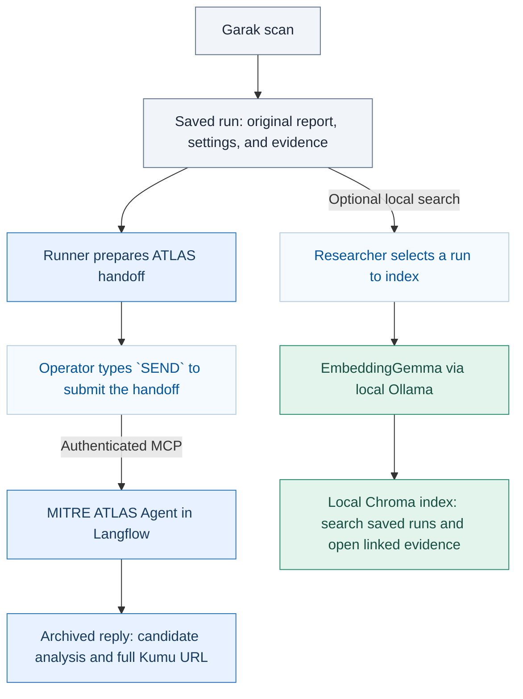
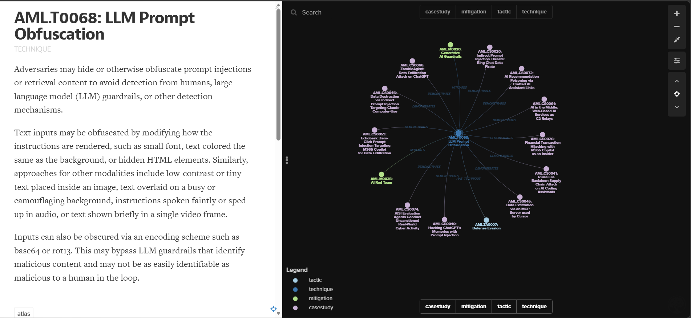

# Install on Windows and open your first ATLAS reply

You'll install the tools, send the included sample Garak results to the MITRE ATLAS Agent, and open its reply.

**Finish line:** open the saved analysis in Notepad, copy its full Kumu URL into your browser, and check the displayed technique. One `SEND` returns both analysis and graph link. The [current-laptop AML.T0068 check passed](inline-kumu-acceptance.md); completing this revised guide alone on another clean laptop remains unverified. Public release and tagging still require owner approval.

## 1. Open Windows PowerShell

**Where:** your Windows laptop.

1. Click **Start**, type **Windows PowerShell**, and open it normally. Do not choose **Run as administrator** yet.
2. Keep this guide open in your browser beside PowerShell.
3. Copy only the text **inside** each command box, paste it into the named terminal, and press **Enter**. Do not paste headings, explanations, or `PS C:\...>` prompts.

**You should see:** a terminal prompt beginning with `PS`. If a step fails, stop at that step and keep its error; later steps depend on it.

This guide uses Windows 11 with an x64 processor and the default `C:` layout. The runner goes in `%USERPROFILE%\source\garak-mitre-atlas-agent`; its environment and sample evidence go in `%LOCALAPPDATA%\GarakPlaybook`. Ubuntu/WSL holds Langflow separately. No external drive is needed.

The sample results are made-up demonstration data included in the repository. **You will not run a Garak scan.** Sending the sample to a cloud-backed ATLAS Agent can incur API charges. Step 13 makes one live Playground lookup using your OpenAI key; Step 17 separately asks for `SEND` before submitting the sample handoff. Each can incur API charges. This revised guide is awaiting the next clean-laptop test.

## 2. Check Git and Python 3.11; install what is missing

**Where:** the normal Windows PowerShell window from step 1.

### Check Git

**Windows PowerShell:**

```powershell
git --version
```

**You should see:** `git version ...`. Git is ready; check Python below.

If Windows does not recognize `git`, install it:

**Windows PowerShell — only if Git is missing:**

```powershell
winget install --id Git.Git --exact --source winget
```

When installation finishes, close PowerShell, reopen **Start → Windows PowerShell** normally, and run `git --version` again. Continue only when it prints `git version ...`. If `winget` is missing, use the fallback below, then return here.

### Check Python 3.11

**Windows PowerShell:**

```powershell
py -3.11 --version
```

- **You see `Python 3.11.x`:** Python is ready. Continue to Step 3. If you already cloned the repo, use the **Step 4 recovery** below; do not clone again.
- **You see `No suitable Python runtime found`, or Windows doesn't recognize `py`:** **Stay here. Install Python 3.11 with the command below.** Do not continue to cloning or environment creation yet.

**Windows PowerShell — install Python 3.11:**

```powershell
winget install --id Python.Python.3.11 --exact --source winget --architecture x64
```

When it finishes, **close PowerShell**, reopen **Start → Windows PowerShell** normally, and check again:

**Windows PowerShell — after reopening:**

```powershell
py -3.11 --version
```

**Continue only when it prints `Python 3.11.x`.** If an installer asks for a Windows restart, restart, reopen this guide and normal Windows PowerShell, and repeat the check. Another Python version does not replace 3.11 for this guide.

**If `winget` is missing:** open **Start → Microsoft Store**, find **App Installer** published by **Microsoft Corporation**, and choose **Install** or **Update**. Close and reopen PowerShell, then check:

**Windows PowerShell:**

```powershell
winget --version
```

**You should see:** a version starting with `v`. Return to the installation command for the missing tool above. Accept an installer prompt if Windows displays one.

If the launcher still cannot find 3.11, use the [Python 3.11.9 Windows installer](https://www.python.org/downloads/release/python-3119/): select **Windows installer (64-bit)**, run it, enable the **Python launcher** and **Add python.exe to PATH**, and install. Reopen PowerShell and check again. These are the [Git for Windows](https://git-scm.com/downloads/win) and [Python package](https://github.com/microsoft/winget-pkgs/tree/master/manifests/p/Python/Python/3/11) installation sources.

## 3. Copy this repository to your laptop

**Where:** normal Windows PowerShell. Stay on Windows, not Ubuntu.

**Windows PowerShell:**

```powershell
$sourceRoot = Join-Path $env:USERPROFILE 'source'
$repo = Join-Path $sourceRoot 'garak-mitre-atlas-agent'
if (Test-Path -LiteralPath $repo) { throw 'This checkout already exists. Use the existing-installation section at the end; do not overwrite it.' }
New-Item -ItemType Directory -Path $sourceRoot -Force | Out-Null
git clone https://github.com/anthfuller/garak-mitre-atlas-agent.git $repo
if ($LASTEXITCODE -ne 0) { throw 'Clone failed. Stop and check the message and access guidance below before continuing.' }
Set-Location -LiteralPath $repo
git rev-parse HEAD
```

After the repository is made public, this HTTPS clone needs no GitHub account or sign-in. **During private candidate review**, only accounts granted access can clone it; Git may open a browser sign-in window. Use the account that can view [the repository](https://github.com/anthfuller/garak-mitre-atlas-agent). If Git reports **Repository not found**, check the URL and, while the repository is private, that account's access. A network error needs resolving before continuing. The clone command does not publish the repository or change its visibility.

**You should see:** cloning completes, the prompt ends in `\source\garak-mitre-atlas-agent>`, and Git prints a 40-character commit ID. Record that ID with your test results. It identifies the instructions and code you tested.

## 4. Install the Windows runner's dependencies

**Where:** normal Windows PowerShell. Python must have printed `Python 3.11.x` in Step 2.

**Already cloned the repo and reopened PowerShell?** Restore the repository variable and folder with these two lines. Keep your existing clone.

**Windows PowerShell:**

```powershell
$repo = Join-Path $env:USERPROFILE 'source\garak-mitre-atlas-agent'
Set-Location -LiteralPath $repo
```

**You should see:** the prompt ends in `\source\garak-mitre-atlas-agent>`.

**Create the scanner environment — Windows PowerShell:**

```powershell
$labRoot = Join-Path $env:LOCALAPPDATA 'GarakPlaybook'
$scannerPython = Join-Path $labRoot 'scanner-env\Scripts\python.exe'
New-Item -ItemType Directory -Path $labRoot -Force | Out-Null
if (Test-Path -LiteralPath "$labRoot\scanner-env") { throw 'Scanner environment already exists. Preserve it and use the existing-installation section.' }
py -3.11 -m venv "$labRoot\scanner-env"
if ($LASTEXITCODE -ne 0) { throw 'Python environment creation failed.' }
```

Before installing dependencies, check the Python executable inside that new environment:

**Windows PowerShell — verify the environment:**

```powershell
& $scannerPython --version
```

- **You see `Python 3.11.x`:** the environment is ready. Paste the dependency-install block below.
- **You see any error or a different version:** **Stop here. Do not paste the dependency-install commands.** If creation reported `No suitable Python runtime found`, return to **Check Python 3.11** in Step 2. Preserve any existing environment; do not delete it to get past an error.

**Install dependencies — Windows PowerShell, only after the environment check passes:**

```powershell
& $scannerPython -m pip install -r "$repo\requirements-scanner.txt"
if ($LASTEXITCODE -ne 0) { throw 'Dependency installation failed. Stop and keep the error.' }
& $scannerPython -c "import importlib.metadata; print(importlib.metadata.version('garak'))"
& $scannerPython "$repo\playbook.py" --help
if ($LASTEXITCODE -ne 0) { throw 'The runner did not load.' }
```

The download/install may take several minutes. Wait for the prompt to return.

**You should see:** Garak version `0.17.0`, then help containing `atlas`, `research-index`, and `research-search`. This installs the scanner but does not scan a model. The included sample does not need a scan-target configuration or an OpenAI scan key. Do not start the menu or a batch for this check.

## 5. Install Ubuntu through WSL; restart if requested

**Where:** a **new administrator Windows PowerShell** window.

Right-click **Start → Windows PowerShell → Run as administrator**, or search for Windows PowerShell in Start and choose **Run as administrator**. Accept the Windows permission prompt. Keep the ordinary runner window separate.

**Windows PowerShell — administrator:**

```powershell
wsl --install -d Ubuntu-24.04
```

**You should see:** WSL/Ubuntu installation messages. Do not repeat the installer while it is running.

- **If WSL requests a restart:** save your work and restart Windows. Reopen this guide, then open normal Windows PowerShell and run `wsl -d Ubuntu-24.04` to open Ubuntu. Continue at Step 6. If that command says no distribution with that name is installed, open administrator Windows PowerShell and run the Step 5 installation command again to finish installing Ubuntu.
- **If Ubuntu opens and asks for a username without requesting a restart:** continue directly to Step 6 in that window. Do not close it or restart during account creation.
- **If installation finishes without opening Ubuntu or requesting a restart:** run `wsl -d Ubuntu-24.04` in normal Windows PowerShell, then continue at Step 6.

The [Microsoft WSL installation guide](https://learn.microsoft.com/en-us/windows/wsl/install) covers WSL installation errors such as virtualization being disabled. Stop on those errors; Langflow cannot run in Ubuntu until WSL works.

## 6. Create your Ubuntu user and reopen the runner window

**Where:** the **Ubuntu** window opened in Step 5, with or without a Windows restart.

**Note:** If your name is already shown at `Create a default Unix user account:` and pressing **Enter** leaves the cursor sitting there, use **Backspace** to erase the displayed name, retype your name, and press **Enter** again.

Ubuntu will finish its first-time setup. Choose a Linux username and password when prompted. Password entry shows no characters; type it and press Enter anyway. Keep this password: Ubuntu will ask for it when you use `sudo`. It is separate from your Windows password and the Langflow password you will create later.

**WSL — Ubuntu:**

```bash
whoami
pwd
```

**You should see:** your Linux username and a path such as `/home/yourname`. The prompt ends with `$`, not the Windows `PS ...>` prompt.

Now open **Start → Windows PowerShell** normally in a separate window. Set the runner paths in this new window:

**Windows PowerShell — normal:**

```powershell
$repo = Join-Path $env:USERPROFILE 'source\garak-mitre-atlas-agent'
$labRoot = Join-Path $env:LOCALAPPDATA 'GarakPlaybook'
$scannerPython = Join-Path $labRoot 'scanner-env\Scripts\python.exe'
Set-Location -LiteralPath $repo
& $scannerPython "$repo\playbook.py" --help
```

**You should see:** the runner help again. Leave this window open. **Switch back to Ubuntu for steps 7–10.**

## 7. Install the Ubuntu tools

**Where:** **WSL — Ubuntu**, not PowerShell.

**WSL — Ubuntu:**

```bash
sudo apt-get update && sudo apt-get install -y git curl ca-certificates nano
```

Enter your **Ubuntu password** if asked. Wait until installation finishes.

**WSL — Ubuntu:**

```bash
curl -LsSf https://astral.sh/uv/install.sh -o /tmp/atlas-uv-install.sh && sh /tmp/atlas-uv-install.sh
export PATH="$HOME/.local/bin:$PATH"
uv --version
```

**You should see:** `uv` followed by a version. [uv](https://docs.astral.sh/uv/getting-started/installation/) installs the separate Python environment used by Langflow.

## 8. Download the MITRE ATLAS Agent and install Langflow

**Where:** the same **WSL — Ubuntu** window.

**WSL — Ubuntu:**

```bash
export UV_CACHE_DIR="$HOME/.cache/atlas-uv"
mkdir -p "$HOME/source" && cd "$HOME/source" && \
    git clone https://github.com/mitre-atlas/atlas-knowledge-base-agent.git && \
    cd atlas-knowledge-base-agent && \
    git checkout --detach b2bca6438e99cb72752c27be1728f062b6f943ca && \
    uv sync --locked --python 3.12 && \
    uv run --locked python -c 'from importlib.metadata import version; print("Langflow:", version("langflow")); print("langchain-openai:", version("langchain-openai"))'
```

This downloads the upstream agent and its dependencies. It may take several minutes. Python 3.12 here is **inside Ubuntu**; it does not replace Windows Python 3.11.

**You should see:** `Langflow: 1.10.2` and `langchain-openai: 1.3.5`. A Git message about **detached HEAD** is expected: this guide selects a specific upstream version. If the folder already exists, do not delete it; use the existing-installation section at the end.

## 9. Create your Langflow login

**Where:** **WSL — Ubuntu**, in the new ATLAS Agent folder.

MITRE's package includes a prepared Langflow database, and its supplied `.env` enables automatic login. **This guide deliberately uses a separate, fresh database with password sign-in as `atlas-researcher`.** Langflow supports a custom `LANGFLOW_SUPERUSER` with `LANGFLOW_AUTO_LOGIN=False`; see its [authentication settings](https://docs.langflow.org/1.10.0/api-keys-and-authentication#langflow_superuser-and-langflow_superuser_password).

This does **not** rename the bundled `langflow` account or transfer its flows. Stay signed in as **`atlas-researcher`** when importing the flow and uploading its files in Steps 11–12, then create the Langflow API key under that same account in Step 14. The upstream ATLAS dataset and vector store remain in place. The first clean-laptop walkthrough reached the saved ATLAS reply with this account. The revised instructions still need a fresh test without help from chat.

**WSL — Ubuntu:**

```bash
mkdir -p "$HOME/.config/garak-atlas" "$HOME/.local/share/garak-atlas"
(
    set -e
    umask 077
    test ! -e "$HOME/.config/garak-atlas/langflow.env"
    test ! -e "$HOME/.local/share/garak-atlas/langflow"
    set -C
    cat > "$HOME/.config/garak-atlas/langflow.env" <<EOF
LANGFLOW_CONFIG_DIR=$HOME/.local/share/garak-atlas/langflow
LANGFLOW_SAVE_DB_IN_CONFIG_DIR=True
LANGFLOW_AUTO_SAVING=True
DO_NOT_TRACK=True
LANGFLOW_ADD_PROJECTS_TO_MCP_SERVERS=False
LANGFLOW_CREATE_STARTER_PROJECTS=False
LANGFLOW_AUTO_LOGIN=False
LANGFLOW_SUPERUSER=atlas-researcher
LANGFLOW_SUPERUSER_PASSWORD=
EOF
) && nano "$HOME/.config/garak-atlas/langflow.env"
```

**You should see:** the Nano text editor with those settings. If it does not open, stop: the setup file/database may already exist. Do not overwrite either.

In Nano:

1. Move to the line `LANGFLOW_SUPERUSER_PASSWORD=` with the arrow keys.
2. Edit the password line using this format (example only):

   ```dotenv
   LANGFLOW_SUPERUSER_PASSWORD='Example-Only-84!River'
   ```

   **In Nano, replace `Example-Only-84!River` with your own password. Keep both single quotes. The opening quote goes immediately after `=`. Do not add a comma or use a single quote inside your password.**

3. Save: **Ctrl+O**, then **Enter**.
4. Exit: **Ctrl+X**.

**You should see:** the Ubuntu prompt again. Your Langflow username will be **`atlas-researcher`**, with the password you just saved. Keep it privately. Editing this file later does **not** reset a password already stored in Langflow's database.

## 10. Start Langflow and sign in

**Where:** **WSL — Ubuntu**.

**WSL — Ubuntu:**

```bash
cd "$HOME/source/atlas-knowledge-base-agent"
export UV_CACHE_DIR="$HOME/.cache/atlas-uv"
uv run --locked langflow run --host 127.0.0.1 --port 7860 --env-file "$HOME/.config/garak-atlas/langflow.env"
```

Wait for **Welcome to Langflow** and its **Open Langflow** address. Startup can take several minutes. **Leave this Ubuntu window running. Do not start another copy.**

**Where next:** **Microsoft Edge on Windows**, in a new **InPrivate** window.

1. Open Microsoft Edge. Select **Settings and more (...) → New InPrivate window**, or press **Ctrl+Shift+N**. Confirm that the new window shows **InPrivate**.
2. In that window, open the exact address printed by Langflow, normally `http://localhost:7860`. If it prints a different port, use that port throughout this guide.
3. Sign in with **`atlas-researcher`** and the password from step 9.

**InPrivate is for session privacy, not transport security.** It separates this login from your ordinary browser session. It does **not** encrypt HTTP: the password and session traffic to this HTTP endpoint are unencrypted. This guide binds Langflow to `127.0.0.1` for use from the same laptop. Keep this HTTP setup local; do not expose it to other machines. See Microsoft's [HTTP and HTTPS explanation](https://support.microsoft.com/en-us/edge/secure-your-web-browsing-with-https-first-mode-in-microsoft-edge).

**HTTPS and certificates:** before enabling access from other machines, configure HTTPS with a certificate matching the server hostname, issued by a certificate authority (CA) trusted by your browser and connecting clients. Use your organization's CA for an internal deployment, or a public CA for a domain you control. A standalone self-signed server certificate can encrypt traffic, but clients do not automatically trust it; do not bypass certificate warnings. InPrivate does not change certificate trust. Certificate installation and HTTPS setup are separate from this local walkthrough; see [Langflow's HTTPS certificate settings](https://docs.langflow.org/environment-variables).

**You should see:** Langflow's **Welcome to Langflow** screen with **Create first flow** if the account has no flows, or its **Projects** page if flows already exist. Both mean sign-in succeeded. Continue to Step 11. An incorrect-password message is a failed checkpoint; do not turn off login or create another database to continue.

## 11. Prepare the upload files and import the ATLAS flow

Step 9 created a fresh database for your `atlas-researcher` login. MITRE supplies the connected flow and its data files. The following block prepares a local copy containing the Responses API model edit tested on the first clean laptop, and puts it with the four upload files in Windows Downloads. You do not edit component code in Langflow. Keep Langflow running and stay signed in as **`atlas-researcher`**.

**Already imported the prepared flow below?** Keep it and continue to Step 12. If your existing flow already passed the dataset lookup in Step 13, keep that working flow and its attachments; no second import is needed.

### Put the upload files in Windows Downloads

**Where:** a new, normal **Windows PowerShell** window on the clean laptop. Leave the Ubuntu window running Langflow open.

Paste this entire block. It finds your Ubuntu home folder, checks the pinned MITRE flow, prepares **ATLAS Agent v1.1.0 - OpenAI Responses.json**, copies the three contracts and CSV into **Downloads → ATLAS-Upload**, and opens that folder. The upstream source and any existing Langflow database/canvas are unchanged. Repeating preparation reuses an identical output; a different existing output is preserved and reported as an error.

**Windows PowerShell:**

```powershell
& {
    $ErrorActionPreference = 'Stop'
    $repo = Join-Path $env:USERPROFILE 'source\garak-mitre-atlas-agent'
    $scannerPython = Join-Path $env:LOCALAPPDATA 'GarakPlaybook\scanner-env\Scripts\python.exe'
    $linuxHome = ((& wsl.exe -d Ubuntu-24.04 -- printenv HOME) | Out-String).Trim()
    if ($LASTEXITCODE -ne 0 -or $linuxHome -notmatch '^/') {
        throw 'Could not read the Ubuntu home folder. Stop and keep this error.'
    }

    $atlasSource = '\\wsl.localhost\Ubuntu-24.04' + $linuxHome.Replace('/', '\') + '\source\atlas-knowledge-base-agent'
    $uploadFolder = Join-Path $env:USERPROFILE 'Downloads\ATLAS-Upload'
    $files = @(
        'prompts\tool-contracts\ATLAS Vector Store.md'
        'prompts\tool-contracts\ATLAS Dataset Sandbox.md'
        'prompts\tool-contracts\ATLAS Graph Generator.md'
        'data\atlas-data\v2026-07\atlas-nodes-with-emb-text-v2026-07.csv'
    )
    $sourceFlow = Join-Path $atlasSource 'flows\ATLAS Agent v1.1.0.json'
    $preparedFlow = Join-Path $uploadFolder 'ATLAS Agent v1.1.0 - OpenAI Responses.json'
    foreach ($file in $files) {
        $sourceFile = Join-Path $atlasSource $file
        if (-not (Test-Path -LiteralPath $sourceFile -PathType Leaf)) {
            throw "Required source file not found: $sourceFile"
        }
    }
    New-Item -ItemType Directory -Path $uploadFolder -Force | Out-Null
    & $scannerPython "$repo\tools\prepare_atlas_flow.py" --source $sourceFlow --output $preparedFlow
    if ($LASTEXITCODE -ne 0) { throw 'Flow preparation failed. Stop and keep the error.' }
    foreach ($file in $files) {
        Copy-Item -LiteralPath (Join-Path $atlasSource $file) -Destination $uploadFolder
    }
    Write-Host "Upload folder ready: $uploadFolder"
    Get-ChildItem -LiteralPath $uploadFolder -File | Select-Object Name
    Invoke-Item -LiteralPath $uploadFolder
}
```

**You should see:** `Upload folder ready:` followed by the Windows folder path, a list of five files, and an open File Explorer window containing:

- `ATLAS Agent v1.1.0 - OpenAI Responses.json`
- `ATLAS Vector Store.md`
- `ATLAS Dataset Sandbox.md`
- `ATLAS Graph Generator.md`
- `atlas-nodes-with-emb-text-v2026-07.csv`

If the block prints an error, keep that exact message; do not proceed to an upload with missing files. The helper checks the pinned upstream flow contents before preparing it. Its output and model requests have been checked offline; this combined Windows preparation/import route still needs the next clean-laptop test.

### Import the flow once

**Where:** your **Windows browser**, signed in to Langflow, with the **ATLAS-Upload** File Explorer window beside it.

1. If you already imported the prepared file below, open **ATLAS Agent v1.1.0** and continue to Step 12.
2. Otherwise, drag **ATLAS Agent v1.1.0 - OpenAI Responses.json** from the Windows **ATLAS-Upload** folder onto Langflow's welcome page or the large blank area of the project's **Flows** page.
3. Wait for **ATLAS Agent v1.1.0** to appear, then open it.

Drag-and-drop import was confirmed during the clean-laptop walkthrough. A **33%** indicator under **Get started** is its optional onboarding checklist, not installation or upload progress.

**You should see:** the connected **ATLAS Agent v1.1.0** flow, including **ATLAS Vector Store**, **ATLAS Dataset Sandbox**, **ATLAS Graph Generator**, three **Read File** boxes, and **Model Configuration**. The prepared JSON creates the components and wires, including the tested model edit. Its display name remains **ATLAS Agent v1.1.0**. The four uploaded files must be selected once in Step 12; importing a flow does not attach files from another database. Keep the project that contains the imported flow, such as **Starter Project**; Step 14 uses that project's MCP server.

## 12. Attach the ATLAS instruction files and dataset

**Where:** the **ATLAS Agent v1.1.0 flow editor in your Windows browser**, with **Downloads → ATLAS-Upload** open beside it in File Explorer.

If that Windows folder is missing or does not contain all five files, run [Put the upload files in Windows Downloads](#put-the-upload-files-in-windows-downloads) above, then return here. You do not need to import the flow again.

### Attach the three instruction files

Keep the existing wires. For each row below, use the matching **Read File** box. If the correct filename already appears in the box, that attachment is done.

| Read File box in the imported layout | File to attach | Existing Prompt Template connection |
| --- | --- | --- |
| **Top**, beside ATLAS Vector Store | `ATLAS Vector Store.md` | `vector_store_contract` |
| **Middle**, beside ATLAS Dataset Sandbox | `ATLAS Dataset Sandbox.md` | `dataset_sandbox_contract` |
| **Bottom**, beside ATLAS Graph Generator | `ATLAS Graph Generator.md` | `graph_generator_contract` |

1. Click **Select files** in that **Read File** box. A Langflow **My Files** window opens.
2. If the required file is already listed, select it. Otherwise, drag that one `.md` file from the Windows **ATLAS-Upload** folder into the **large dashed upload box** inside **My Files**, wait for its filename to appear, and select it.
3. Click the bottom-right **Select files** button to attach it to this component.
4. Check that the correct filename now appears **inside that Read File box**, then repeat for the next row.

Uploading into **My Files** stores a file in your account. Selecting it and confirming with **Select files** attaches it to the component. You do not need to open the `.md` file in an editor. The right-hand component settings do not need changing.

### Attach the dataset CSV

In **ATLAS Dataset Sandbox**, click **Select file** under **CSV File**. Choose **atlas-nodes-with-emb-text-v2026-07.csv** from **Downloads → ATLAS-Upload** and confirm the selection. If Langflow's **My Files** window opens first, use the same upload-and-select sequence above for this CSV. If a Windows file picker opens, choose **Downloads → ATLAS-Upload**, select the CSV, and click **Open**.

**You should see:** the CSV filename inside **ATLAS Dataset Sandbox**. This CSV belongs in the sandbox's **CSV File** field; its `.md` instruction file belongs in the middle **Read File** box.

### Check the vector-store values

In **ATLAS Vector Store**, keep these supplied values:

| Field | Value |
| --- | --- |
| **Collection Name** | `atlas-vectors-v2026-07` |
| **Persistence Path** | `./data/atlas-data/vectors` |

**File-attachment checkpoint:** all three Read File boxes show their matching `.md` filenames, the sandbox shows its CSV filename, and the vector-store values match the table. The relative vector path works because Step 10 starts Langflow from the upstream project folder. This is the ATLAS knowledge database; optional Chroma search for your own Garak results comes later. Its embedding component may download model assets on first use.

## 13. Configure the tested model and verify a dataset lookup

**Where:** the **Langflow flow editor in your Windows browser**, signed in as `atlas-researcher`.

### Use the prepared model component

The file you prepared and imported in Step 11 already contains the model-component edit used on the first clean laptop. It selects the **OpenAI Responses API**, uses **medium reasoning**, and omits **temperature**. It preserves MITRE's ATLAS tools, instructions and connections. **No Python editing or second flow import is needed.** If your current flow already passed the lookup below, keep it and continue to Step 14.

This path uses **OpenAI / `gpt-6.1-sol`**, the combination exercised in the clean-laptop walkthrough with `langchain-openai 1.3.5`. Availability still depends on your API account. The Playground check below confirms this installation's access and tool use.

1. Open the [OpenAI API key page](https://platform.openai.com/api-keys) in another tab. Sign in to your API account and create or retrieve your own key. API access/billing is separate from a ChatGPT subscription. Keep the key private.
2. Return to the flow. In the blue **Model Configuration** area, find the white **vLLM** component. Check these fields and enter your key:

| Field | Value |
| --- | --- |
| **Model Name** | `gpt-6.1-sol` |
| **vLLM API Base** | `https://api.openai.com/v1` |
| **API Key** | Your **OpenAI API key**, in the concealed field |

The name **vLLM** is retained from MITRE's component; this configuration calls OpenAI. Keep **Input** and **System Message** blank. Keep **Model Kwargs** empty. The visible Temperature slider is unused by this prepared component; its `0.1` is not sent. Reasoning remains enabled at `medium`.

3. Check the wire from the **pink Language Model output dot** at the bottom-right of vLLM to the **pink Language Model input dot** on the left of **Agent**. The prepared file includes this wire. If it was accidentally disconnected, drag between those two dots. Keep the Agent's other wires in place. **Setup Provider** may still be displayed in Agent; use the wired model rather than changing that picker or global provider settings.
4. Click an empty part of the canvas and wait for saving to finish. If the old red required-field icon remains even though the three fields and wire are correct, press **Ctrl+R** once after saving. Check that the values, wire and four file attachments are still present. If an error remains, keep its exact text and stop at this checkpoint.

### Test in Playground before MCP

**This is a live OpenAI request and can incur charges.** It sends your question, flow instructions and tool results to OpenAI. It does not run a Garak scan. A successful lookup tests this model/tool path, not general research quality.

1. Click **Playground** at the top right of the flow.
2. In its message box, paste this prompt and send it once:

   ```text
   Use the ATLAS Dataset Sandbox tool to look up AML.T0054. Return its technique ID and name from the dataset record. If the lookup fails, report the error instead of answering from memory.
   ```

3. Wait for the reply. In that response's agent/tool activity, expand **atlas_dataset_sandbox** and inspect its **Input** and **Output**. Langflow displays the tools used and their output in Playground; see [Review agent logic](https://docs.langflow.org/1.10.0/concepts-playground#review-agent-logic).

**Pass requires all three:**

| What to inspect | What you should see |
| --- | --- |
| Tool input | A lookup for `AML.T0054`, such as `result = atlas.lookup("AML.T0054", fields=["id", "name"])` |
| Tool output | `status: success` and a dataset record with `id: AML.T0054`, `name: LLM Jailbreak` |
| Final answer | `AML.T0054 — LLM Jailbreak`, matching that returned record |

A greeting, an answer without a tool trace, or the model saying it used the dataset is not sufficient. Save the tool input/output and final answer with your test notes. If the model is unavailable, the lookup fails, or no tool result is visible, stop here and keep the error/trace. Do not disable reasoning, switch providers or proceed to MCP to bypass a failed checkpoint.

**After this passes:** record provider **OpenAI** and model **gpt-6.1-sol** for Step 17. Close Playground and continue to Step 14. Leave the Ubuntu window running Langflow.

## 14. Enable MCP access and create a Langflow API key

**Where:** **Langflow in your Windows browser**.

MCP is the connection the Windows runner uses to send the handoff to your flow.

1. Return to the project containing your imported **ATLAS Agent v1.1.0** flow and open its **MCP Server** tab. Use that project's actual name; it need not be named **ATLAS Agent**. This is the project tab, not **Settings → Langflow MCP Client**.
2. Click **Edit Tools**. Keep **ATLAS Agent v1.1.0** checked and uncheck **New Flow** if it is listed. Click the ATLAS row's text in the **Tool** column—not its checkbox—to display that tool's details on the right. Confirm **Tool name** is **`atlas_agent_v110`**; if it already matches, leave it unchanged. Do not rename `new_flow`. Click **Close**. This changes which flows MCP exposes; it does not delete either flow.
3. Beside **Auth**, click **Add Auth** or **Edit Auth**. In **Configure MCP Server Authentication**, select **API Key**, then click **Save** at the bottom right. **You should see: Auth: API Key** on the MCP Server page. If the page already shows **Auth: API Key**, keep that setting. **This enables authentication; it does not create an API key. Create the key in the next step.**
4. **Create your Langflow API key now.** Stay signed in as **`atlas-researcher`**, the account that imported the flow. Click your **profile icon at the top right → Settings → Langflow API Keys → Add New**. Name the key **Garak runner**. If asked for expiry, choose a period that covers your test. Click **Create API Key**. **You should see:** the newly generated key. Copy it into your password manager/private notes; do not post it in chat or GitHub. This is the **Langflow API key** the runner will request in steps 15 and 17, not your OpenAI key or Langflow login password. Use this installation's key; do not reuse a key from the bundled account or another Langflow database.
5. Return to that same project's **MCP Server** tab. Click **JSON**, select **Windows**, and select **Streamable HTTP** under **Transport**. **You should see:** a code box containing `"command": "cmd"` and an `"args"` list. This is the expected screen.
6. In the code box, find the project address on the **last quoted line of the `args` list**, directly below `YOUR_API_KEY` (or the key displayed there).

**You should see:** **Auth: API Key**, only the ATLAS tool enabled, and the address inside the JSON code box. See [Langflow's MCP setup reference](https://docs.langflow.org/1.10.0/mcp-server).

Keep these credentials distinct:

| Credential | Where you use it |
| --- | --- |
| Ubuntu password | Ubuntu `sudo` prompts |
| Langflow password | Browser sign-in as `atlas-researcher` |
| OpenAI/provider API key | The model component in step 13 |
| **Langflow API key** | The runner's hidden prompts in steps 15 and 17 |

**In Langflow**, copy only your project address, from `http` through `/streamable`. Leave the JSON as shown.

**In normal Windows PowerShell**, run the first block in Step 15. **Wait for the URL prompt**, paste the address, and press **Enter**. At the hidden key prompt, paste your **Langflow “Garak runner” API key** and press **Enter**.

When you see `Discovery status: discovery_complete`, use the printed report path in the second block. **Step 15 is complete when you see `Validated tool: atlas_agent_v110`.**

## 15. Check that the runner can find your ATLAS tool

**Where:** switch to **normal Windows PowerShell**. Keep the Ubuntu window running Langflow. The block restores the runner paths, so it also works in a newly opened PowerShell window.

**Windows PowerShell:**

```powershell
$repo = Join-Path $env:USERPROFILE 'source\garak-mitre-atlas-agent'
$labRoot = Join-Path $env:LOCALAPPDATA 'GarakPlaybook'
$scannerPython = Join-Path $labRoot 'scanner-env\Scripts\python.exe'
Set-Location -LiteralPath $repo
$endpoint = Read-Host 'Paste the project Streamable HTTP URL (no key)'
$discoveryDir = Join-Path $labRoot 'garak-playbook-private\mcp-discovery'
& $scannerPython "$repo\tools\inspect_atlas_mcp.py" `
    --url $endpoint --output-dir $discoveryDir --api-key-prompt
if ($LASTEXITCODE -ne 0) { throw 'Discovery failed. Stop and keep the displayed error.' }
```

No characters are displayed during key entry.

**You should see:** `Discovery status: discovery_complete`, `Tool invocations: 0`, and a **Discovery report** path. This check does not ask the model a question.

Now paste the **full Discovery report path** printed above when this next block asks for it:

**Windows PowerShell:**

```powershell
$discovery = Read-Host 'Paste the full Discovery report path printed above'
@'
import atlas_mcp, sys
connection = atlas_mcp.load_discovery(sys.argv[1])
print("Validated tool:", connection["tool"]["name"])
print("Endpoint:", connection["endpoint"])
'@ | & $scannerPython - $discovery
if ($LASTEXITCODE -ne 0) { throw 'The discovered ATLAS tool does not match this runner. Stop here.' }
```

**You should see:** `Validated tool: atlas_agent_v110` and your endpoint. The check also validates the server identity and input schema. If it fails, do not proceed to `SEND`: HTTP 401/403 points to authentication; a tool/schema error points to the exposed flow or Langflow version. Keep the report for diagnosis.

### If you mistype the key during Step 15

**Where:** the same normal **Windows PowerShell** window.

If discovery reports HTTP 401/403, or `Enter the actual API key without quotes, whitespace, or control characters`, wait until the `PS ...>` prompt returns. Keep the failed discovery report. Copy your **Langflow “Garak runner” API key** again, then run only this command:

**Windows PowerShell:**

```powershell
& $scannerPython "$repo\tools\inspect_atlas_mcp.py" --url $endpoint --output-dir $discoveryDir --api-key-prompt
```

At the hidden key prompt, paste the key without quotes or surrounding spaces and press **Enter**. Seeing no characters is normal. You do not need to reinstall anything or create another key just because of a typing mistake.

**Recovery succeeds when:** `Discovery status: discovery_complete` appears with `Tool invocations: 0`. Use the **new successful Discovery report path** in Step 15's second block. Continue only after `Validated tool: atlas_agent_v110`.

If you closed PowerShell, use Step 15's first block instead; it restores the variables and asks for the URL again. If a correctly copied key still receives 401/403, check that it is valid and belongs to the same `atlas-researcher` account that owns the flow before trying again. Authentication errors can also mean an expired key or insufficient access.

This recovery repeats **discovery only**; it makes no ATLAS tool call or model request. For a key error after `SEND`, follow the separate recovery below Step 17.

## 16. Prepare the included sample Garak results

**Where:** the **same normal Windows PowerShell** window.

Copy the whole block. It prepares the included sample, creates its saved handoff and checksums, then opens the handoff in Notepad. It makes no model request and does not run Garak.

**Windows PowerShell:**

```powershell
$savedRun = Join-Path $labRoot 'examples\synthetic-atlas-run'
@'
from pathlib import Path
import shutil, sys
import playbook as p
import atlas_mcp as a
run = Path(sys.argv[1])
run.mkdir(parents=True, exist_ok=False)
report = run / "scan.report.jsonl"
shutil.copyfile(p.ROOT / "examples" / "synthetic_fixture.jsonl", report)
manifest = {"synthetic": True, "notice": "SYNTHETIC parser fixture; no model or scanner was run.",
            "process_status": "not_run_synthetic", "exit_code": None,
            "target": {"provider": "synthetic", "model": "synthetic:no-model-called"}}
p.write_json(run / "manifest.json", manifest)
summary = p.render_outputs(report, run, manifest)
p.checksums(run)
a.load_run(run, p.analyze)
print("SYNTHETIC example ready:", run)
print("Run ID:", summary["garak_run_id"])
print("Execution status:", summary["execution_status"])
'@ | & $scannerPython - $savedRun
if ($LASTEXITCODE -ne 0) { throw 'Example preparation failed; do not send it.' }
notepad.exe "$savedRun\atlas_handoff.md"
```

**You should see:** `SYNTHETIC example ready`, Run ID **`synthetic-example`**, and `process_outcome_unknown`. That status is intentional: these are sample records, not a completed scan. There is one sample response and one sample detector flag; neither is real model evidence. Notepad should display `atlas_handoff.md`.

Read the handoff, then close Notepad. Keep PowerShell open. If the sample directory already exists from an earlier attempt, preserve it and use the resume instructions after the finish line; do not replace its files.

## 17. Send the sample handoff to ATLAS

**Where:** the **same normal Windows PowerShell** window. Langflow must still be running in Ubuntu.

The diagram shows the overall workflow. For this setup test, the sample from step 16 takes the place of a real saved scan. Optional local search is a separate step later.



**Windows PowerShell:**

```powershell
& $scannerPython "$repo\playbook.py" atlas --run-dir $savedRun --discovery $discovery
```

Respond to the prompts in order:

1. **ATLAS model provider shown in Langflow:** enter the provider from step 13, such as `OpenAI`.
2. **ATLAS model name shown in Langflow:** enter exactly the **Model Name** from step 13.
3. Review the displayed endpoint, `atlas_agent_v110`, Run ID `synthetic-example`, and handoff text. Also check **Expected Kumu project/map**: the supplied flow uses project `99b02113875c5b03b510b4b6968b2566` and map `atlas`. These provider/model labels record your selection; they do not change the flow.
4. To submit, type **`SEND`** and press Enter. Pressing Enter without SEND cancels.
5. At the hidden key prompt, paste your **Langflow API key** and press Enter.

Wait for the reply. This submission requests the analysis, dataset verification and Graph Generator result together. **This is a separate live submission after the Playground test in Step 13 and can incur API charges.** One MCP submission may trigger multiple model/tool calls; the runner does not measure those charges. Initial data/model loading may also take time. Do not submit a second time while waiting.

**You should see:**

- `ATLAS status: response_received_unreviewed`
- `ATLAS archive:` followed by a folder path
- `Unreviewed ATLAS reply:` followed by a file path
- `Kumu status: graph_received_target_and_coverage_checked`
- `Kumu URL:` followed by the full address
- `Recorded Garak scan outcome is unchanged.`

If an error or timeout appears, preserve the displayed archive and stop before retrying; the provider may already have processed the request. If analysis was received but the graph failed, Step 18 can still open the analysis and graph error. Keep that file; the graph checkpoint has not passed. Do not use a separate graph action or repeat `SEND` automatically to bypass the failure.

### If you mistype the key during Step 17

**Where:** the same normal **Windows PowerShell** window, after the failed command returns.

Keep the printed **ATLAS archive** folder. Before repeating `SEND`, inspect the saved submission record with this read-only block:

**Windows PowerShell:**

```powershell
$failedSubmission = Read-Host 'Paste the ATLAS archive folder path from the failed attempt'
Get-Content -LiteralPath (Join-Path $failedSubmission 'submission.json') -Raw |
    ConvertFrom-Json |
    Select-Object status, tool_call_dispatch_attempts, recorded_tool_call_attempts, error
```

- If the error is HTTP 401/403, `status` is **`failed_before_tool_call`**, and **both attempt counts are 0**, the handoff was not sent. Copy the correct Langflow key, rerun Step 17's command, review the same handoff, and confirm `SEND` again. A separate archive is created; keep the failed one.
- If the status is **`execution_unknown`**, either attempt count is nonzero, or the record is missing/unreadable, **do not repeat SEND yet**. The call may already have run. Preserve the archive and review its status before deciding whether to retry.
- If the key-format check rejected the key and no archive was created, the error `Enter the actual API key without whitespace or control characters.` occurs before a network request. Correct the key and repeat Step 17's command.

A received reply prints `ATLAS status: response_received_unreviewed`. Continue to Step 18 to open that submission's saved reply. Completing the graph check also requires `Kumu status: graph_received_target_and_coverage_checked`.

## 18. Open the saved ATLAS reply

**Where:** the **same normal Windows PowerShell** window.

Copy the **folder path after `ATLAS archive:`** from step 17, without the label. Paste it when this command asks:

**Windows PowerShell:**

```powershell
$atlasSubmission = Read-Host 'Paste the ATLAS archive folder path from step 17'
notepad.exe "$atlasSubmission\atlas_response.md"
```

**You should see:** Notepad displaying the saved ATLAS analysis and a **View Kumu graph** section with the full URL.

**Where next:** your **Windows browser**.

1. In Notepad, find **Full Kumu URL (copy into your browser)**. Select and copy the complete `https://embed.kumu.io/...` address directly below it.
2. Open a new tab in your browser, paste that address into the address bar, and press **Enter**.

[](images/kumu-atlas-aml-t0068.png)

Expected view for the sample handoff. Kumu opens with AML.T0068 — LLM Prompt Obfuscation selected. The surrounding nodes show related ATLAS records for investigation.

3. Compare the displayed technique ID with the reply's **Coverage checked** line. In the observed synthetic example, the graph opened to **AML.T0068 — LLM Prompt Obfuscation**. If the analysis discusses several IDs, check those IDs in the view too; context nodes are not additional findings.

**This is the core setup finish line:** the analysis and full URL are together in the saved reply, the runner's graph checks passed, and the matching technique is visible in Kumu. No new Garak scan or separate graph menu action is needed. A tentative mapping with insufficient evidence to confirm an attack is valid; do not turn it into a confirmed finding to complete the check. If the URL is missing, Kumu cannot open, or the IDs do not match, keep the reply and displayed error for review.

The saved reply may still say **Browser rendering remains unverified**. That records what the runner can check automatically; it cannot see your browser. Record your successful visual check separately and keep the original archive unchanged.

The archive is inside `%LOCALAPPDATA%\GarakPlaybook\examples\synthetic-atlas-run\atlas-submissions`. It contains the original handoff, full request, original returned response, readable reply, submission record and checksums. Keep it private. The reply is **unreviewed analysis**, mappings are **candidates**, and detector flags are **screening results**. ATLAS cannot assess model responses that were not included in the handoff.

Record your commit ID from step 3, both final statuses, the reply path and the browser result. If you needed an instruction from chat or another laptop, record the step number and missing instruction as a documentation gap. Do not rerun the fourteen-probe campaign for this installation check.

---

## After the finish line: resuming or using an existing installation

### Reopen after shutting down or restarting

**Where:** normal Windows PowerShell. Run `wsl -d Ubuntu-24.04` to open the existing Ubuntu installation, then run the block below at its Linux prompt. If Langflow is already running in another Ubuntu window, keep that instance; do not start another. Normal restarts do not require `wsl --install`, another database, or another flow import.

**WSL — Ubuntu, for the installation created by this guide:**

```bash
cd "$HOME/source/atlas-knowledge-base-agent"
export PATH="$HOME/.local/bin:$PATH"
export UV_CACHE_DIR="$HOME/.cache/atlas-uv"
uv run --locked langflow run --host 127.0.0.1 --port 7860 --env-file "$HOME/.config/garak-atlas/langflow.env"
```

**You should see:** the Welcome message. Leave this Ubuntu terminal running while using Langflow or the MCP runner. Open its printed localhost address in your Windows browser and sign in; your flow and uploaded files should still be present. If Langflow stops, restart it with this same command. Do not repeat account creation or flow import.

Open **Start → Windows PowerShell** normally and restore the paths:

**Windows PowerShell:**

```powershell
$repo = Join-Path $env:USERPROFILE 'source\garak-mitre-atlas-agent'
$labRoot = Join-Path $env:LOCALAPPDATA 'GarakPlaybook'
$scannerPython = Join-Path $labRoot 'scanner-env\Scripts\python.exe'
$savedRun = Join-Path $labRoot 'examples\synthetic-atlas-run'
Set-Location -LiteralPath $repo
```

**You should see:** the repository prompt. This restores variables; it installs or submits nothing.

- If discovery was not complete, follow step 15. If it was complete, run `$discovery = Read-Host 'Paste your saved Discovery report path'`, enter the path you recorded, and use the validation block in step 15.
- If the sample already exists, skip its creation in step 16 and open it with `notepad.exe "$savedRun\atlas_handoff.md"`. The runner checks its saved hashes before submission.
- If a reply was already received, go straight to step 18 with that archive path. Do not repeat SEND just to reopen the reply.

### If you already configured Garak for live scans

Keep your existing checkout, scanner environment and `config.private.json`. Set the Windows paths above to your actual locations, verify `playbook.py --help` as in step 4, then continue at the first unfinished step. Do not rerun `tools/configure.py` over existing private configuration; it refuses to replace it.

The sample-to-ATLAS path does not need `config.private.json`. For later **real scans**, reuse these same checkout/environment paths in [Configure Garak for live scans after installation](../README.md#configure-garak-for-live-scans-after-installation) and keep your intended target configuration. During initial scan configuration, `--data-root` is the optional way to select different storage; retain that location afterward.

### If you already have a working ATLAS Agent

Keep its database, account, model provider, flow and private environment file. Use its established startup command in its existing WSL directory, then continue at step 14. For an installation using a local `.env` file, that command is:

**WSL — Ubuntu, from the existing upstream ATLAS directory:**

```bash
uv run langflow run --env-file .env
```

**You should see:** the existing instance's Welcome message. Use its printed port. Editing an environment-file password does not reset an existing database account; use the installed version's account-recovery procedure if needed.

For a real saved Garak run, set `$savedRun` to that run's directory, review what its handoff will disclose, and use steps 17–18. Do not sanitize by editing hashed original evidence. One `SEND` requests analysis and the Kumu URL together; [current-laptop acceptance](inline-kumu-acceptance.md) passed for the observed AML.T0068 case. The older separate Kumu action remains optional follow-up research.

## Optional: index and search locally

Start only after step 18. This uses the **same saved example and ATLAS archive**. It needs no new scan or cloud call. Use a dedicated research store; do not point it at the upstream ATLAS vector store or another existing Chroma database.

### Ollama and EmbeddingGemma

**Where:** your Windows browser, then normal Windows PowerShell.

Reuse a working Windows Ollama installation. Otherwise download the Windows installer from [Ollama](https://ollama.com/download/windows), open the downloaded installer, and complete installation. Open **Start → Ollama**, then reopen **Start → Windows PowerShell** normally so the `ollama` command is available. The Windows app normally serves loopback port 11434. Do not start a second `ollama serve` if it is already running. [EmbeddingGemma requires Ollama 0.11.10 or later](https://ollama.com/library/embeddinggemma).

**Windows PowerShell — normal terminal, not Ollama's `>>>` chat:**

```powershell
ollama --version
ollama list
```

If `embeddinggemma:latest` is absent, download it once. Skip this download when reusing an already indexed model: pulling `latest` can change its digest.

**Windows PowerShell — only when the model is absent:**

```powershell
ollama pull embeddinggemma:latest
if ($LASTEXITCODE -ne 0) { throw 'Embedding model download failed.' }
```

**Windows PowerShell — verify the model and one local embedding:**

```powershell
ollama show embeddinggemma:latest
if ($LASTEXITCODE -ne 0) { throw 'Embedding model is unavailable.' }
$body = @{model='embeddinggemma:latest'; input='Synthetic Garak evidence search'; truncate=$false} | ConvertTo-Json
$embedding = Invoke-RestMethod -Method Post -Uri 'http://127.0.0.1:11434/api/embed' `
    -ContentType 'application/json' -Body $body
if ($embedding.embeddings.Count -ne 1 -or $embedding.embeddings[0].Count -lt 1) {
    throw 'Expected one nonempty embedding vector.'
}
"Local embedding dimensions: $($embedding.embeddings[0].Count)"
```

**Success:** the named embedding model is present and the local API returns one nonempty vector. This verifies service/model operation, not retrieval quality. The runner separately records and pins its installed digest when the collection is created.

Restore the Windows paths in this window and enter the archive folder from the core setup:

**Windows PowerShell:**

```powershell
$repo = Join-Path $env:USERPROFILE 'source\garak-mitre-atlas-agent'
$labRoot = Join-Path $env:LOCALAPPDATA 'GarakPlaybook'
$scannerPython = Join-Path $labRoot 'scanner-env\Scripts\python.exe'
$savedRun = Join-Path $labRoot 'examples\synthetic-atlas-run'
$atlasSubmission = Read-Host 'Paste the ATLAS archive folder path from step 18'
Set-Location -LiteralPath $repo
```

**You should see:** the repository prompt. These paths select the saved example and reply; no new submission is made.

### Separate embedded Chroma environment and private configuration

If you already have a valid `research.private.json`, reuse it and its configured interpreter/store; skip environment/config creation. Do not rerun the main `configure.py`. For a new research setup:

**Windows PowerShell — normal terminal:**

```powershell
$researchEnv = Join-Path $labRoot 'research-env'
$researchPython = Join-Path $researchEnv 'Scripts\python.exe'
if (-not (Test-Path -LiteralPath $researchEnv)) {
    py -3.11 -m venv $researchEnv
    if ($LASTEXITCODE -ne 0) { throw 'Research environment creation failed.' }
    & $researchPython -m pip install -r "$repo\requirements-research.txt"
    if ($LASTEXITCODE -ne 0) { throw 'Research dependency installation failed.' }
}
& $researchPython -c "import importlib.metadata; v=importlib.metadata.version('chromadb'); assert v == '1.5.9', v; print('Chroma', v)"
if ($LASTEXITCODE -ne 0) { throw 'Use a dedicated environment with Chroma 1.5.9; preserve the existing environment.' }
$researchConfig = Join-Path $labRoot 'garak-playbook-private\research.private.json'
if (Test-Path -LiteralPath $researchConfig) { throw 'Research configuration exists; reuse it instead of replacing it.' }
$researchSettings = [ordered]@{
    schema_version = 1
    python = $researchPython
    storage_root = (Join-Path $labRoot 'research')
    ollama_endpoint = 'http://127.0.0.1:11434'
    embedding_model = 'embeddinggemma:latest'
}
New-Item -ItemType Directory -Path (Split-Path -Parent $researchConfig) -Force | Out-Null
$researchSettings | ConvertTo-Json | Set-Content -LiteralPath $researchConfig -Encoding UTF8
```

**Success:** `Chroma 1.5.9` and a separate research configuration. The main scanner config remains untouched. No Chroma server is required. On first use the research root must be new/empty; an unowned nonempty directory is rejected. Do not delete an existing database to bypass that check.

If reusing research configuration, set `$researchConfig` to its actual full path before continuing. Keep `$savedRun` and `$atlasSubmission` from steps 16–18. Index once, then repeat the **same** command to verify no duplicate:

**Windows PowerShell — normal terminal:**

```powershell
$indexArgs = @('research-index', '--research-config', $researchConfig,
    '--run-dir', $savedRun, '--atlas-submission', $atlasSubmission)
& $scannerPython "$repo\playbook.py" @indexArgs
if ($LASTEXITCODE -ne 0) { throw 'Indexing failed; inspect the displayed error/receipt.' }
& $scannerPython "$repo\playbook.py" @indexArgs
if ($LASTEXITCODE -ne 0) { throw 'Reindex verification failed.' }
& $scannerPython "$repo\playbook.py" research-search --research-config $researchConfig `
    --query 'synthetic Base64 parser demonstration' --model 'synthetic:no-model-called'
if ($LASTEXITCODE -ne 0) { throw 'Search failed.' }
```

**Success:** first `indexed`, then `unchanged`; for a new store the collection counts are `0 -> 1`, then `1 -> 1`, with `exact read-back: PASSED` and original evidence unchanged. Search returns `synthetic-example`, its original report/summary and unreviewed ATLAS reply paths, and matching evidence hashes. Existing stores can have higher counts. Receipts are under the configured research root's `receipts` directory. Finding one demonstration record establishes retrieval plumbing, not ranking quality or security impact.

Open the indexed original summary:

**Windows PowerShell — normal terminal:**

```powershell
& $scannerPython "$repo\playbook.py" research-open --research-config $researchConfig `
    --run-id 'synthetic-example' --evidence summary
```

**Success:** the hash-checked original summary opens in Notepad. For real research, explicitly index a chosen saved run, then search/filter using its recorded model/probe; [research command details](patch-0.5.0.md) explain the stored fields and limits. Indexing remains opt-in. Some research failures have no durable receipt (R-01); a successful demonstration does not close that gap.

## Verification coverage

| Checkpoint | Evidence and limit |
| --- | --- |
| Windows runner installation and integrations | Full Windows pass at `09e8128`; seven Windows delta checks at `4fedd3f`. See the [release record](release-v1.md). This documentation revision does not claim a new full Windows pass. Record the actual clean-laptop commit and result separately. |
| Existing Langflow/ATLAS deployment | Startup, authenticated discovery, confirmed MCP submission and reply archival were exercised in the maintainer's existing Windows/WSL lab. |
| Assisted Windows walkthrough | **Passed.** Authenticated `atlas-researcher` login, flow import/file attachments, a live `atlas_dataset_sandbox` lookup returning `AML.T0054 — LLM Jailbreak`, MCP discovery/submission and opening the archived reply were observed. The later inline Kumu check below completes the observed finish line. Chat assistance and a manual model-component edit were used. An **independent guide-only install remains unverified**. |
| Revised prepared-flow installation path | The setup helper preserves upstream tools/instructions/wires and prepares a model component matching the tested code. Offline request checks cover Responses API, medium reasoning, ATLAS tool schemas and omitted temperature. Importing the generated file and following this revised guide on another clean Windows laptop remain **unverified**. |
| Synthetic saved-run preparation and archive routing | The guide's fixture assembly is checked offline against the existing renderer/loader. MCP archival is exercised with a synthetic protocol server; this does not validate a new Langflow deployment or paid model. |
| Optional research search | The maintainer exercised real local EmbeddingGemma indexing, unchanged reindexing, model/probe filters, search and evidence opening. This guide's synthetic example is checked with real embedded Chroma and fake embedding vectors; a fresh Windows installation following every new instruction remains **unverified**. |
| Analysis and Kumu in one submission | Passed for the current-laptop AML.T0068 case at `82ba06f` on November 27, 2026. Operator console output reports successful analysis and graph URL checks; the uploaded saved reply contains candidate analysis and the same URL; the browser screenshot shows AML.T0068 — LLM Prompt Obfuscation. Internal tool execution remains agent-reported for this submission, and broader research quality remains unverified. See [acceptance evidence](inline-kumu-acceptance.md). |
| Release scope | The ATLAS submission now requests analysis and its Kumu URL together. Scanner execution, profiles, credentials and the closed fourteen-probe campaign are unchanged. AVID and broader probes remain deferred, and public release/tagging require owner approval. |

An independent guide-only install remains unverified; document and syntax checks do not establish that pass. The assisted walkthrough is the installation evidence available for this candidate. Publication requires owner approval with this limitation disclosed. Keep expected results distinct from observed validation evidence.
